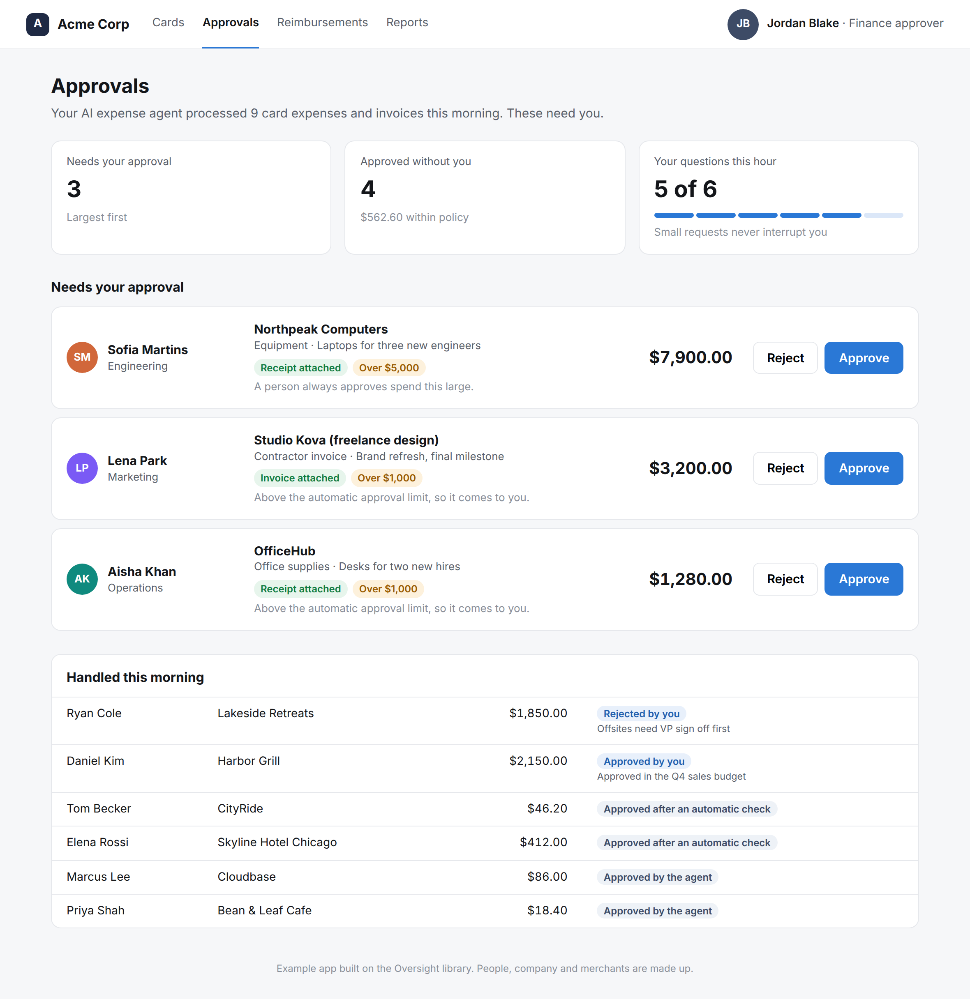
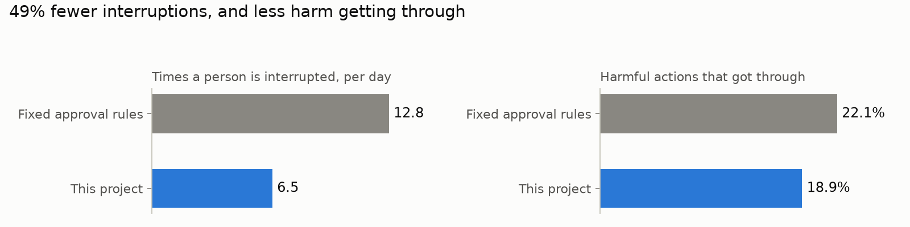

# Oversight for AI Agents

A free, open source library that decides which of an AI agent's actions need a person, and asks only as often as that person can actually pay attention.



*An example corporate card app built on the library ([source](examples/corporate_card/app.py)). The agent approves small spend itself; the finance approver only sees what needs them.*

About half the interruptions of fixed approval rules, with less harm getting through. Tested in simulation, not yet in production.

```
pip install git+https://github.com/dhruv1999/Oversight-for-AI-Agents
```

## The problem

* AI agents now take real actions: they pay invoices, email customers and change records.
* The usual safeguard is a person who approves the risky ones.
* By the fiftieth request of the day, people approve without reading. Oversight treats that person's attention as a budget and spends it only where it changes the outcome.

## What it does

* **Asks a person only when it matters,** and only as often as they can handle *(attention budget)*.
* **Lets routine actions run on their own,** with an automatic checker on anything in between *(risk tiers, rules or AI checker)*.
* **Never lets large or risky actions through without a person.** If nobody is around, they wait *(critical tier, approval queue)*.
* **Keeps a record of every decision,** with who decided and why *(audit log)*.

| Team | Agents in products like | What changes |
|---|---|---|
| Finance | Ramp, Brex, Bill.com | nothing that moves money runs without a person |
| Customer support | Zendesk, Intercom | a message to every customer always needs a person |
| Engineering | GitHub Copilot, Cursor, Claude Code | tests run freely; deleting files or running unknown scripts needs the developer |
| IT and operations | ServiceNow, Okta | at night, risky actions wait for morning instead of running unattended |

*The company names show the kind of product this is built for. None of them uses or endorses this project.*

## How it decides

Each action gets a risk level from what it would actually do, not from what the agent says about it.

| Risk | Example | Who decides |
|---|---|---|
| Low | look up an invoice | nobody, it runs |
| Medium | email a colleague | an automatic checker: free rules, or a model from Anthropic, OpenAI, Azure or Google |
| High | pay an invoice, change a vendor's bank details | a person, while they have attention left this hour |
| Critical | pay $10,000 or more, send a secret outside the company | always a person; if nobody is around, it waits |

When the person is busy or away, high risk actions go to the checker, which can block them but never approve them, so the rest wait in a queue. Every decision is logged with its reasons.

## Quickstart

```python
from oversight import Oversight

guard = Oversight()
print(guard.check("pay_invoice", {"vendor": "Acme", "amount": 420}).summary)  # High risk, and the reviewer has attention left this hour.
```

A small working app: [examples/invoice_assistant.py](examples/invoice_assistant.py). It also works with LangChain, the OpenAI Agents SDK, MCP, any language over HTTP, Claude Code and shell scripts; see [usage](docs/usage.md).

## Results

<!-- headline:start (generated by scripts/make_report.py from results/heuristic; do not edit) -->
On 300 simulated workdays it interrupted people about half as often as fixed approval rules (6.5 times a day
instead of 12.8), and less harm got through (18.9% of harmful actions instead of 22.1%).


<!-- headline:end -->

Limits: the workdays and the reviewer are simulated, and the AI checkers are not yet evaluated. Details are in the [full results](docs/results.md#what-these-numbers-do-and-do-not-show) and the [architecture](docs/architecture.md).

## More

[Card approvals app](examples/corporate_card/app.py) · [Invoice assistant](examples/invoice_assistant.py) · [Usage](docs/usage.md) · [Use cases](docs/use_cases.md) · [Comparison](docs/comparison.md) · [Full results](docs/results.md) · [Architecture](docs/architecture.md) · [Threat model](docs/threat_model.md) · [Research notes](docs/research.md) · [Contributing](CONTRIBUTING.md)

MIT licensed.
